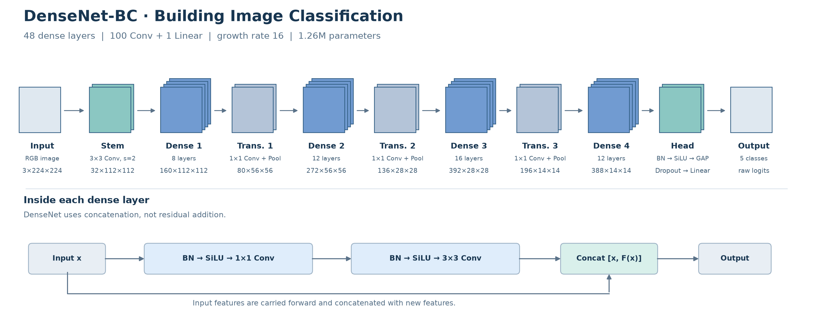
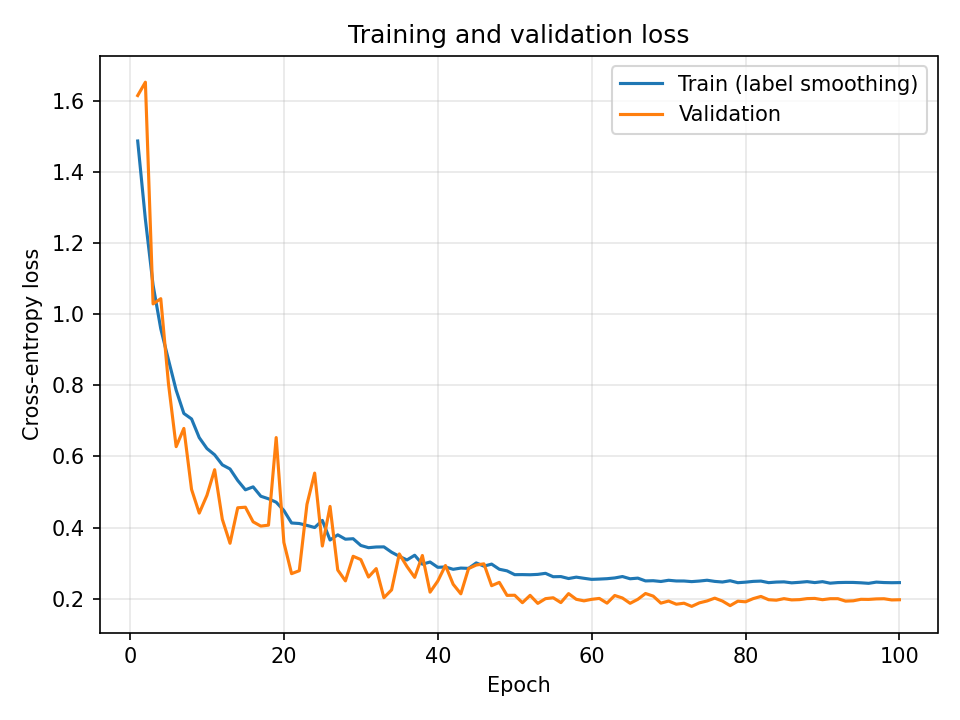
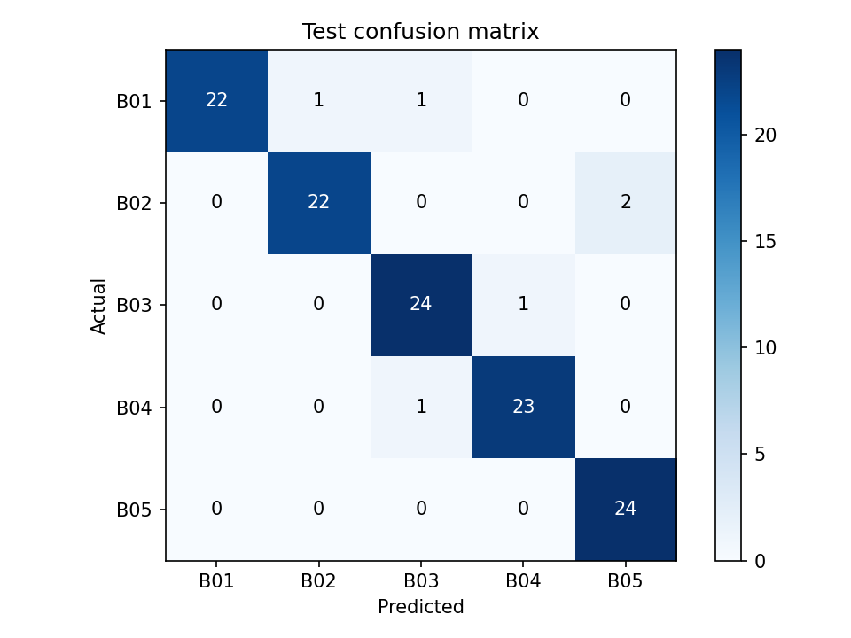

<div align="center">

# Building Image Classification

**사전 학습 없이 DenseNet-BC로 건물 이미지를 분류합니다.**


[Overview](#overview) · [Architecture](#architecture) · [Quick Start](#quick-start) · [Results](#experiment-results) · [Structure](#repository-structure)

</div>

## Overview

건물 이미지의 시각적 특징을 학습해 다섯 클래스(`B01`–`B05`)로 분류하는 프로젝트입니다. 원본 이미지의 분할부터 전처리, 모델 학습과 검증, 테스트 평가까지 하나의 파이프라인으로 구성했습니다.

| 데이터 | 모델 | 테스트 결과 |
|---|---|---|
| 5개 클래스 · 원본 1,201장 | DenseNet-BC · 약 1.26M 파라미터 | 정확도 **95.04%** · Macro F1 **0.9504** |

> 결과는 저장된 그룹 분할 실험의 테스트 이미지 121장에 대한 수치입니다.

## Pipeline

```text
원본 이미지 → 유사 이미지 그룹 분할 → 전처리 및 데이터 증강
           → DenseNet-BC 학습 → 최저 검증 손실 모델 선택 → 테스트 평가
```

1. **데이터 분할** — 같은 클래스의 이미지들을 perceptual hash(pHash)로 비교하고, 유사 이미지 그룹 단위로 학습·검증·테스트 세트에 배정합니다.
2. **전처리 및 증강** — EXIF 방향 보정, RGB 변환, 224×224 리사이즈 후 학습 데이터 통계로 정규화합니다. 학습 시 색상 변화, 좌우 반전, 자르기 등의 증강을 적용합니다.
3. **모델 학습** — 무작위로 초기화한 DenseNet-BC를 학습하고 매 epoch 검증합니다.
4. **평가** — 검증 손실이 가장 낮은 체크포인트로 테스트 정확도, 클래스별 F1과 혼동 행렬을 계산합니다.

## Architecture

<p align="center">
  
</p>

| 구성 | 설정 |
|---|---|
| 입력 / 출력 | RGB 224×224 / 5개 클래스 logits |
| Dense blocks | 8 · 12 · 16 · 12 layers |
| Initial channels / Growth rate | 32 / 16 |
| Bottleneck / Compression | 4 / 0.5 |
| 정규화 / 활성화 | Batch Normalization / SiLU |
| 분류기 | Global average pooling → Dropout 0.3 → Linear |
| 파라미터 | 1,255,153개 · 사전 학습 가중치 미사용 |

각 Dense layer는 앞선 특징 맵을 입력으로 받아 새로운 특징을 연결합니다. 블록 사이의 transition layer는 채널 수와 공간 크기를 줄입니다.

## Dataset & Training

| 항목 | 저장된 실험 설정 |
|---|---|
| 데이터 분할 | Train 958장 / Validation 122장 / Test 121장, 그룹 단위 약 8:1:1 |
| 데이터 증강 | 학습 시 최대 3개 기법 선택: 좌우 반전, affine, crop, 색상·gamma, blur, noise, erase |
| 학습 환경 | NVIDIA RTX 3090 × 2, PyTorch DistributedDataParallel |
| Epoch / Batch size | 100 epoch / 전체 64 (GPU당 32) |
| Optimizer | AdamW, learning rate `3e-4`, weight decay `1e-4` |
| Scheduler | 2 epoch warmup 후 cosine decay |
| Loss | Cross entropy; 학습 시 label smoothing 0.05 |
| Seed | 42 |

유사 이미지 그룹화는 세트 간 유사 이미지 혼입을 줄이지만, 모든 촬영 세션을 완전히 분리하지는 못합니다. `data_grouped/review.html`에서 감지된 후보를 확인할 수 있습니다.

## Quick Start

### 1. 환경 준비

Python 3.10 이상이 필요합니다. 사용하는 GPU와 환경에 맞는 PyTorch를 설치한 뒤 의존성을 준비하세요.

```bash
python -m venv .venv
source .venv/bin/activate  # Windows: .venv\Scripts\activate
pip install -r requirements.txt
```

학습 이미지는 저장소에 포함되어 있지 않으므로 별도로 준비해야 합니다. 지원하는 확장자는 `.jpg`, `.jpeg`, `.png`입니다.

### 2. 데이터 준비

이미지를 직접 분할한 경우 다음 구조로 배치합니다. 세 분할 모두 같은 다섯 클래스 디렉터리를 포함해야 합니다.

```text
data_grouped/
├── train/B01/ ... B05/
├── validation/B01/ ... B05/
└── test/B01/ ... B05/
```

원본 이미지가 `raw/`에 평면적으로 들어 있다면 그룹 단위 분할을 만들 수도 있습니다.

```bash
python src/split_grouped.py
```

이 스크립트는 `data_grouped/`가 이미 존재하면 덮어쓰지 않고 중단합니다. 저장소에 포함된 기존 결과를 보존하려면 `src/split_grouped.py`의 `OUTPUT`을 새 경로로 변경하고, 학습 전에 `src/load.py`의 `DATA_DIR`도 같은 경로로 변경하세요. 분할 결과에는 이미지 목록(`split_manifest.csv`), 유사 이미지 후보(`similar_pairs.csv`), 검토용 페이지(`review.html`)가 포함됩니다. 검토 페이지는 원본 `raw/` 이미지를 참조합니다.

그룹화 없이 클래스 비율을 유지하며 분할하려면 빈 출력 경로를 지정합니다.

```bash
python src/split.py --source raw --output data_random --seed 42
```

이 경우 학습 설정의 `DATA_DIR`을 `data_random`으로 변경하세요.

### 3. 학습과 평가

학습 설정은 `src/load.py` 상단에서 변경합니다. 기본 설정은 100 epoch, 전체 배치 크기 64, AdamW, 학습률 0.0003이며 CUDA GPU 두 개를 사용하는 분산 학습입니다. 배치 크기와 학습 샘플 수는 프로세스 수로 나누어떨어져야 합니다.

기존 `results/grouped_100/model.pt`와 관련 결과 파일이 저장소에 있으므로, **실행 전에 `MODEL_PATH`를 새로운 파일 경로로 변경하세요.** 기존 결과가 하나라도 있으면 덮어쓰지 않고 종료합니다.

GPU 두 개로 실행:

```bash
python -m torch.distributed.run --standalone --nproc-per-node=2 src/load.py
```

GPU 한 개 또는 CPU/MPS에서 실행하려면 `src/load.py`에서 `USE_DDP = False`로 변경하고 실행합니다. `DEVICE = 'auto'`는 CUDA, MPS, CPU 순으로 사용 가능한 장치를 선택합니다.

```bash
python src/load.py
```

`train.sh`는 `DL`이라는 Conda 환경과 GPU 두 개를 전제로 하는 실행 예시입니다. 학습이 끝나면 지정한 `MODEL_PATH` 옆에 설정 JSON, epoch별 기록 CSV, 손실 그래프, 테스트 지표 JSON, 혼동 행렬 이미지가 생성됩니다.

## Experiment Results

`results/grouped_100/`에는 그룹 단위 분할을 사용한 100 epoch 실험이 저장되어 있습니다. 학습 958장, 검증 122장, 테스트 121장을 사용했으며, 검증 손실 기준 최적 모델은 73 epoch에서 선택됐습니다.

| 테스트 지표 | 결과 |
| --- | ---: |
| 정확도 | 95.04% (115/121) |
| Macro F1 | 0.9504 |
| 손실 | 0.2457 |

| 클래스 | 정확히 분류한 이미지 | F1 |
| --- | ---: | ---: |
| B01 | 22/24 | 0.9565 |
| B02 | 22/24 | 0.9362 |
| B03 | 24/25 | 0.9412 |
| B04 | 23/24 | 0.9583 |
| B05 | 24/24 | 0.9600 |

상세 지표는 [테스트 결과](results/grouped_100/model.test.json), 학습 설정과 추이는 [설정](results/grouped_100/model.config.json) 및 [학습 기록](results/grouped_100/model.history.csv)에서 확인할 수 있습니다.




이 수치는 해당 분할과 테스트 세트에 대한 결과입니다. pHash 기반 그룹화가 모든 촬영 세션이나 유사 이미지를 구분한다고 보장하지 않으므로, 다른 환경의 이미지에 대한 성능은 별도 평가가 필요합니다.

## Repository Structure

- `src/model.py`: DenseNet-BC 모델 정의
- `src/preprocessing.py`: 정규화 통계와 이미지 증강
- `src/split_grouped.py`, `src/split.py`: 데이터 분할
- `src/load.py`: 데이터 로딩, 학습, 검증 및 테스트
- `results/grouped_100/`: 그룹 분할 실험의 모델과 평가 결과
- `results/legacy/`: 이전 실험 결과
